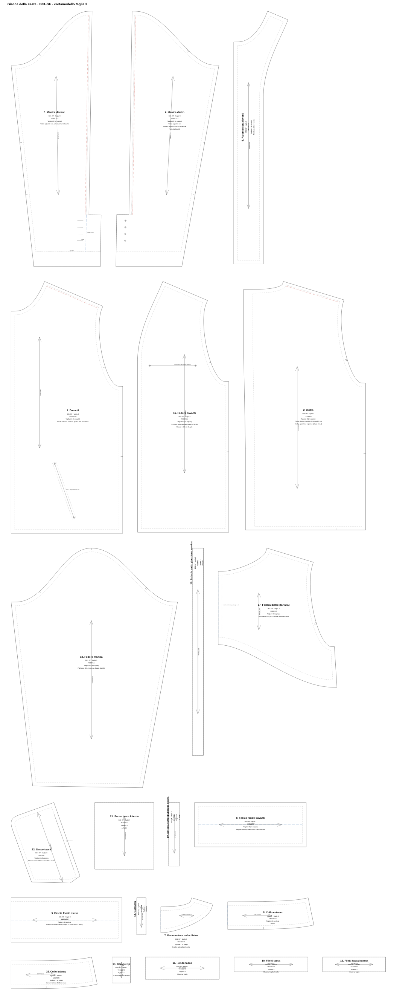

# Cartamodello — Giacca della Festa (B01-GF), taglia 3



## Quale file usare

| File | Per chi | Uso |
|---|---|---|
| `cartamodello-giacca-t3-A4.pdf` | Chi stampa in casa o in studio | 55 pagine A4 in scala 1:1, più la copertina con la mappa delle pagine e il quadrato di controllo |
| `cartamodello-giacca-t3-plotter.pdf` | Copisteria o plotter | Foglio unico 112 × 270 cm in scala 1:1 |
| `cartamodello-giacca-t3.dxf` | Laboratorio, modellista CAD | DXF R12 in millimetri, un blocco per pezzo, livelli in stile AAMA: 1 taglio, 4 tacche, 7 drittofilo, 8 linee interne e pieghe, 13 fori, 14 cucitura, 15 testi. Importabile in Gerber, Lectra, Optitex, CLO3D: controllare scala e livelli all'import. |
| `cartamodello-giacca-t3.svg` | Visione a schermo, Illustrator | Tavola 1:1 in millimetri |
| `verifica-misure.md` | Tutti | Misure del capo ricavate dal cartamodello e controllo delle cuciture |

## Stampa A4

1. Stampare al **100%** (scala reale, senza "adatta alla pagina").
2. Misurare il quadrato sulla copertina: deve essere **10 × 10 cm**.
3. Affiancare le pagine seguendo la mappa in copertina (lettere = righe, numeri = colonne) e unire i triangoli sui bordi.

## Come leggere i pezzi

- **Linea continua:** taglio. I margini di cucitura sono **inclusi**: 1 cm salvo dove indicato.
  - Centro dietro: 2,5 cm di riserva per allargare il capo.
  - Orlo della manica: 4 cm.
  - Orlo della fodera a farfalla: 2 cm.
  - Pezzi rettangolari: misure già al taglio.
- **Tratteggio grigio:** linea di cucitura.
- **Tratto rosso:** piega della **giunzione a giorno**. I due bordi si ripiegano 3 mm prima della linea nominale, così resta un vuoto di 6 mm. Sotto il vuoto va la striscia di fodera rosa (pezzi 19 e 20).
- **Tratto blu:** pieghe (pezzi su piega, spacco manica, fasce).
- **Tacche:** segni di montaggio. Una tacca sul davanti e due sul dietro del giro manica; tacche al gomito sul sottomanica.
- **Fori:** estremità delle tasche e posizione dei bottoni.

## Pezzi (22)

| # | Pezzo | Materiale | Taglio |
|---|---|---|---|
| 1 | Davanti | Tessuto | 2 in coppia |
| 2 | Dietro | Tessuto | 2 in coppia |
| 3 | Manica davanti | Tessuto | 2 in coppia |
| 4 | Manica dietro | Tessuto | 2 in coppia |
| 5 | Collo esterno | Tessuto | 1 su piega |
| 6 | Paramontura davanti | Tessuto | 2 in coppia |
| 7 | Paramontura collo dietro | Tessuto | 1 su piega |
| 8 | Fascia fondo davanti | Tessuto | 2 in coppia |
| 9 | Fascia fondo dietro | Tessuto | 1 su piega |
| 10 | Filetti tasca | Tessuto | 4 |
| 11 | Fondo tasca | Tessuto | 2 |
| 12 | Filetti tasca interna | Tessuto | 2 |
| 13 | Garage zip | Tessuto | 1 |
| 14 | Catenella | Tessuto | 1 |
| 15 | Collo interno | Melton | 1 su piega |
| 16 | Fodera davanti | Fodera | 2 in coppia |
| 17 | Fodera dietro (farfalla) | Fodera | 1 su piega |
| 18 | Fodera manica | Fodera | 2 in coppia |
| 19 | Striscia sotto giunzione spalla | Fodera | 2 |
| 20 | Striscia sotto giunzione manica | Fodera | 2 |
| 21 | Sacco tasca interna | Fodera | 2 |
| 22 | Sacco tasca | Tasche | 4 (2 coppie) |

**Teletta:** paramonture, collo esterno, metà esterna delle fasce, filetti, strisce di 2 cm lungo i bordi a giorno.
**Elastico** della fascia dietro: 4 cm di altezza, 53,6 cm di lunghezza.

## Prima della produzione

Il cartamodello è costruito sulle misure della scheda tecnica e i controlli geometrici tornano. Prima di tagliare il tessuto vero, però, serve una **tela di prova** (toile) indossata da corpi diversi: uomo e donna, taglia 3 e taglie vicine. Le correzioni della prova vanno riportate nei parametri all'inizio di `brand/strumenti/cartamodello_giacca.py`; poi si rigenerano tutti i file con:

```
python3 brand/strumenti/cartamodello_giacca.py
```
