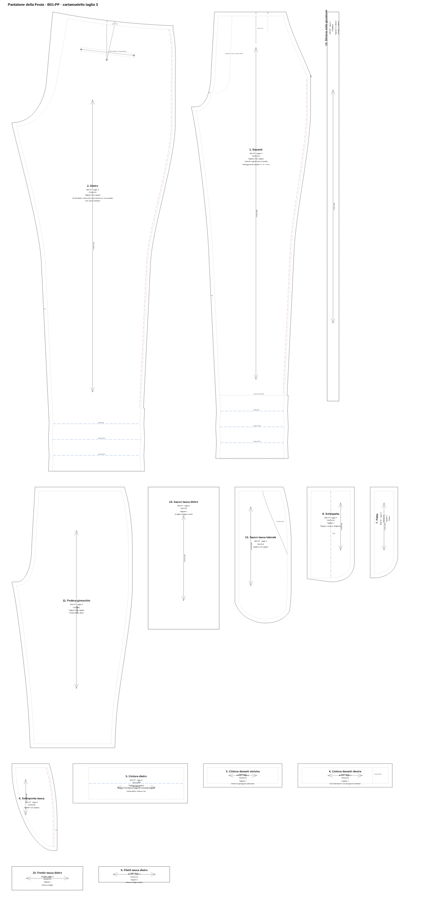

# Cartamodello — Pantalone della Festa (B01-PF), taglia 3



## Quale file usare

| File | Per chi | Uso |
|---|---|---|
| `cartamodello-pantalone-t3-A4.pdf` | Chi stampa in casa o in studio | 47 pagine A4 in scala 1:1, più la copertina con la mappa e il quadrato di controllo |
| `cartamodello-pantalone-t3-plotter.pdf` | Copisteria o plotter | Foglio unico 112 × 228 cm in scala 1:1 |
| `cartamodello-pantalone-t3.dxf` | Laboratorio, modellista CAD | DXF R12 in millimetri, un blocco per pezzo, livelli in stile AAMA (come per la giacca) |
| `cartamodello-pantalone-t3.svg` | Visione a schermo, Illustrator | Tavola 1:1 in millimetri |
| `verifica-misure.md` | Tutti | Misure del capo e controllo delle cuciture |

Per la stampa A4 e la lettura dei segni vale quanto scritto nel [README della giacca](../../giacca-della-festa/cartamodello/README.md).

## Particolarità del pantalone

- **Cucitura laterale spostata di 2 cm verso il davanti**, perché la giunzione a giorno si veda di fronte come la riga di una tuta.
  - Le due laterali sono lunghe esattamente uguali (96,5 cm fino al risvolto): la giunzione a giorno non ammette agio.
  - Sopra i 16 cm la giunzione corre sulla sottopunta della tasca (pezzo 6).
- **Riserva al centro dietro:** 4 cm in cintura che scendono a 1 cm sul cavallo, più 4 cm al centro della cintura dietro. Servono per allargare il pantalone e farlo passare di mano.
- **Risvolto di 4 cm.**
  - Sotto il fondo finito il pezzo prosegue di 12 cm: 2 × 4 cm di risvolto + 4 cm di orlo.
  - I fianchi sono specchiati a ogni piega, perché il risvolto segua la rastremazione della gamba.
  - Le linee blu segnano fondo finito e pieghe.
- **Cintura dietro con elastico:** 3 cm di altezza, 42,1 cm di lunghezza. A riposo la vita misura 78 cm, in estensione 84 cm.

## Pezzi (14)

| # | Pezzo | Materiale | Taglio |
|---|---|---|---|
| 1 | Davanti | Tessuto | 2 in coppia |
| 2 | Dietro | Tessuto | 2 in coppia |
| 3 | Cintura davanti sinistra | Tessuto | 1 |
| 4 | Cintura davanti destra (con estensione) | Tessuto | 1 |
| 5 | Cintura dietro | Tessuto | 2 in coppia |
| 6 | Sottopunta tasca | Tessuto | 2 in coppia |
| 7 | Patta | Tessuto | 1 |
| 8 | Sottopatta | Tessuto | 1 |
| 9 | Filetti tasca dietro | Tessuto | 2 |
| 10 | Fondo tasca dietro | Tessuto | 1 |
| 11 | Fodera ginocchio | Fodera | 2 in coppia |
| 12 | Striscia sotto giunzione | Fodera | 2 in sbieco |
| 13 | Sacco tasca laterale | Tasche | 4 (2 coppie) |
| 14 | Sacco tasca dietro | Tasche | 1 |

## Prima della produzione

Come per la giacca, serve una tela di prova su corpi diversi. In particolare vanno controllati:
- il cavallo dietro (36,6 cm cintura inclusa);
- la tenuta della giunzione a giorno sul fianco quando ci si siede.

Le correzioni vanno nei parametri all'inizio di `brand/strumenti/cartamodello_pantalone.py`; poi si rigenera con:

```
python3 brand/strumenti/cartamodello_pantalone.py
```
